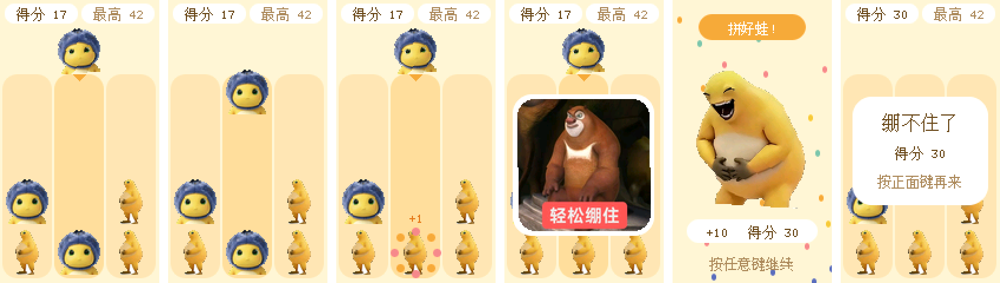
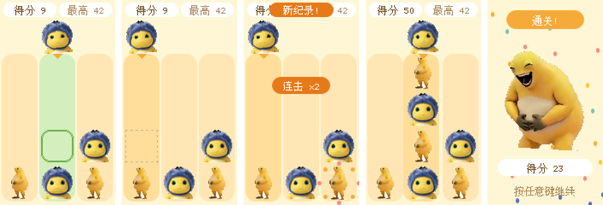

# 拼好蛙（M5Stack StickS3 掉落合成小游戏）

三列格子，奶娃从上面掉下来。落在一样的奶娃上就合成升级；落在不一样的上面，熊大跳出来，配上原声：“轻松绷住”。合成出第 3 级时全屏大笑，笑声循环播放，按任意键继续。



从左到右：等待下落、下落中、合成、轻松绷住、合成第 3 级、绷不住了。

## 怎么玩

| 按键 | 作用 |
| --- | --- |
| 侧面键 | 换到下一列（三列循环） |
| 正面键 | 让奶娃掉下去 |
| 按住正面键 3 秒 | 重新开始 |
| 快速摇三下板子 | 直接通关：全屏大笑，按任意键后棋盘清空，分数保留 |

- 第 1 级 + 第 1 级 → 第 2 级（+1 分）
- 第 2 级 + 第 2 级 → 第 3 级（+3 分），全屏大笑并循环笑声（+10 分），按任意键后它离开棋盘
- 落在不一样的奶娃上 → 熊大弹出“轻松绷住”，同时播放原声，奶娃留在原地
- 合成可以连锁：新合成的奶娃和它下面的一样，会继续合成
- 某一列已经堆满还往里放 → 这一列抖一下并提示，换一列就行；三列全满才算“绷不住了”，按正面键再来
- 下一个奶娃大多是第 1 级，偶尔（15%）直接给第 2 级
- 最高分保存在板子上，断电不丢

## 让人一上手就会玩的小细节



- **摇一摇通关**：0.9 秒内快速摇三下，直接进入“通关!”大笑画面，笑声循环；按任意键继续，棋盘清空、分数保留。
- **合成提示**：当前列落下去能合成时，整列变浅绿，落点出现绿色框；不能合成时落点是灰色虚线框。落下前就知道结果。
- **满列不判输**：满的那一列会抖一下并响两声低音，不会因为一次误按就结束。
- **连击**：一次落下引发连锁合成时，弹出“连击 x2”。
- **新纪录**：本局第一次超过最高分时，顶部弹出“新纪录!”并响一声。
- **闲置变暗**：30 秒没人按键，屏幕自动调暗省电；任意键唤醒，唤醒的那一下不会触发换列或下落。

## 烧录（Mac）

```bash
brew install platformio        # 或 pipx install platformio
cd pin-hao-wa
pio run -t upload
pio device monitor             # 可选：每次合成、轻松绷住、大笑都会打印一行
```

图片和笑声已经转换好放在 `src/assets/` 里，直接烧录即可。上传时找不到端口：长按机身侧面复位键，直到内部绿灯闪烁（进入下载模式），再执行一次 `pio run -t upload`。

## 素材

`assets/source/` 里是原始素材：

| 文件 | 用途 |
| --- | --- |
| `wa1.png` | 第 1 级（初始奶娃） |
| `wa2.png` | 第 2 级 |
| `wa3.png` | 第 3 级（大笑） |
| `oops.png` | 合成失败时弹出的熊大“轻松绷住” |
| `laugh.wav` | 第 3 级出现时循环播放的笑声（原视频第 1–4 秒，已去掉开头静音） |
| `oops.wav` | 熊大弹出时播放的“轻松绷住”原声（第二个视频的第 3–4.5 秒） |

换素材后在 `pin-hao-wa` 文件夹运行一次转换脚本，再烧录：

```bash
pip3 install pillow numpy scipy
python3 tools/build_assets.py
```

脚本会自动抠掉奶娃图片的白色背景，缩成 40×40 的格子图和 120×120 的大笑图；熊大图裁成带圆角的正方形。两段声音也可以直接放视频：`laugh.mp4` 截取第 1–4 秒，`oops.mp4` 截取第 3–4.5 秒（需要 `brew install ffmpeg`）。

## 可调的参数（`src/main.cpp` 顶部）

| 参数 | 默认值 | 作用 |
| --- | --- | --- |
| `VOLUME` | 180 | 音量，满值 255；用电池时别超过约 190 |
| `DROP_MS_ROW` | 75 | 每下落一格的时间（毫秒） |
| `TOAST_MS` | 1900 | 熊大“轻松绷住”显示多久（比 1.5 秒的原声略长） |
| `DIM_AFTER_MS` | 30000 | 多久没人按键就调暗屏幕 |
| `SHAKE_G` / `SHAKE_COUNT` / `SHAKE_WINDOW` | 1.9 g / 3 次 / 900 毫秒 | 摇一摇的灵敏度：每下多用力、摇几下、在多长时间内 |
| `LEVEL2_CHANCE` | 15 | 下一个直接是第 2 级的概率（%） |
| `CELEBRATE_MAX` | 20000 | 没人按键时，大笑最长持续多久（毫秒） |

如果按下去发现正面键和侧面键作用反了，在 `loop()` 里把 `BtnA` 和 `BtnB` 对调即可。
