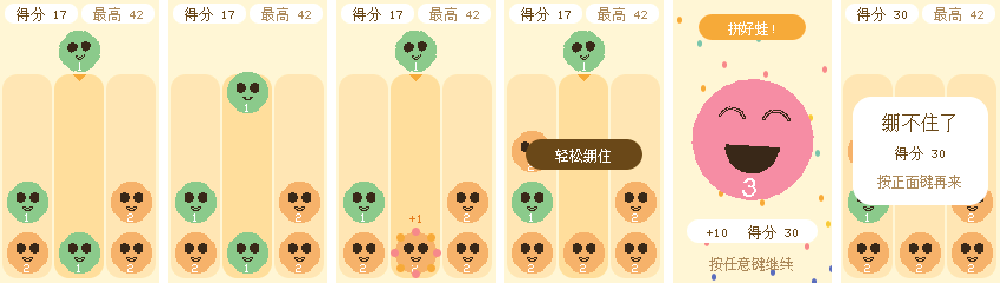

# 拼好蛙（M5Stack StickS3 掉落合成小游戏）

三列格子，奶娃从上面掉下来。落在一样的奶娃上就合成升级，落在不一样的上面就弹出“轻松绷住”。合成出第 3 级时全屏大笑，笑声循环播放，按任意键继续。



上图用的是仓库自带的数字圆脸占位图。放入你自己的三张奶娃图片后，画面会换成你的图（见下文“换成你的奶娃”）。

## 怎么玩

| 按键 | 作用 |
| --- | --- |
| 侧面键 | 换到下一列（三列循环） |
| 正面键 | 让奶娃掉下去 |
| 按住正面键 3 秒 | 重新开始 |

- 第 1 级 + 第 1 级 → 第 2 级（+1 分）
- 第 2 级 + 第 2 级 → 第 3 级（+3 分），全屏大笑并循环笑声（+10 分），按任意键后它离开棋盘
- 落在不一样的奶娃上 → “轻松绷住”，奶娃留在原地
- 合成可以连锁：新合成的奶娃和它下面的一样，会继续合成
- 某一列已经堆满还往里放 → “绷不住了”，按正面键再来
- 下一个奶娃大多是第 1 级，偶尔（15%）直接给第 2 级
- 最高分保存在板子上，断电不丢

## 换成你的奶娃（只在你的电脑上，不上传）

图片和笑声可能有版权，所以它们不进 Git。做法：

1. 把 `wa1.png`、`wa2.png`、`wa3.png` 和 `laugh.wav`（或原视频 `laugh.mp4`）放进 `assets/local/`。
2. 在 `pin-hao-wa` 文件夹运行：

   ```bash
   pip3 install pillow numpy scipy
   python3 tools/build_assets.py
   ```

   脚本会自动抠掉白色背景，把图片缩成 40×40 的格子图和 120×120 的大笑图；笑声会截取视频第 1–4 秒，再去掉首尾静音，并在首尾加淡入淡出，方便无缝循环。用视频或 mp3 需要先装 ffmpeg：`brew install ffmpeg`。
3. 生成的 `src/assets/sprites_user.h` 和 `src/assets/laugh_user.h` 也不会提交。固件编译时检测到它们就用你的素材，没有就用占位图和合成笑声，所以不放素材也能编译。

## 烧录（Mac）

```bash
brew install platformio        # 或 pipx install platformio
cd pin-hao-wa
python3 tools/build_assets.py  # 放好本机素材后执行一次
pio run -t upload
pio device monitor             # 可选：每次合成、轻松绷住、大笑都会打印一行
```

上传时找不到端口：长按机身侧面复位键，直到内部绿灯闪烁（进入下载模式），再执行一次 `pio run -t upload`。

## 可调的参数（`src/main.cpp` 顶部）

| 参数 | 默认值 | 作用 |
| --- | --- | --- |
| `VOLUME` | 180 | 音量，满值 255；用电池时别超过约 190 |
| `DROP_MS_ROW` | 75 | 每下落一格的时间（毫秒） |
| `TOAST_MS` | 1300 | “轻松绷住”显示多久 |
| `LEVEL2_CHANCE` | 15 | 下一个直接是第 2 级的概率（%） |
| `CELEBRATE_MAX` | 20000 | 没人按键时，大笑最长持续多久（毫秒） |

如果按下去发现正面键和侧面键作用反了，那是这块板的按键编号和预期不同，在 `loop()` 里把 `BtnA` 和 `BtnB` 对调即可。
