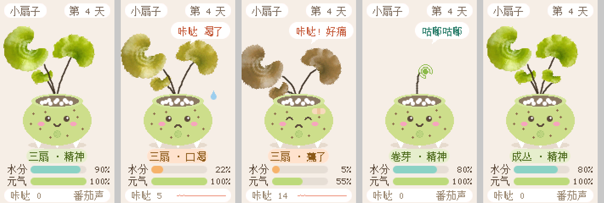

# 小扇子：会咔哒的口袋植物（M5Stack StickS3）

一株 Q 版盆栽住在 StickS3 里。叶片是从真实照片里抠出来的，缺水或被敲时，喇叭播放的是真实植物在干旱和受伤时发出的超声咔哒声。



从左到右：精神、口渴（自动咔哒）、蔫了并受伤、刚浇水的卷芽、长成一丛。


每一声咔哒都是先出动效、再出声音：叶子先开始发抖，茎上散开两圈波纹，大约 0.45 秒后响起真实的咔哒声，同时弹出气泡。被敲时动效缩短到 0.2 秒，反应更快。

## 提示音

| 时机 | 声音 | 画面 |
| --- | --- | --- |
| 水分刚降到 30% 以下 | “叮—咚”两声 | 盆边跳出一个蓝色水滴，气泡显示“该浇水啦” |
| 仍然口渴 | 每 30 秒再提醒一次 | 同上 |
| 水分低于 8%（蔫了） | 三声下行的音，听起来更委屈，每 15 秒一次 | 深蓝水滴，气泡显示“快浇水! 要蔫了” |
| 浇完水 | 三声上行的“叮叮叮” | 水滴落下，气泡显示“咕嘟咕嘟” |

提示音是开发板合成的音调；只有咔哒声是真实的植物录音。

## 演示怎么玩（只有三个动作）

| 动作 | 效果 |
| --- | --- |
| 按正面键 | 浇水：水分回满，咔哒声停止 |
| 按侧面键 | 快进半天：水分下降，缺水时立刻听到一串真实咔哒 |
| 用力晃一下或敲一下 | 受击：播放真实的“剪切”咔哒，元气下降，盆上贴创可贴 |

不操作时，一分钟算植物的一天，水分会慢慢下降。水分低于 30% 开始自动咔哒，越来越密；低于 8% 植物蔫掉，咔哒反而变稀，这对应论文发现的“先升后降”规律。

隐藏操作：按住侧面键 1.5 秒，在番茄录音和烟草录音之间切换；按住正面键 3 秒，从头开始。

> 如果实际按下去发现正面键和侧面键的功能是反的，说明这块板的按键编号顺序和预期不同，不影响演示，按实际情况记住即可。

## 烧录（Mac）

```bash
# 1. 安装 PlatformIO（任选一种）
brew install platformio        # 或：pipx install platformio

# 2. 用支持数据传输的 USB-C 线连接 StickS3，然后：
cd plant-pet
pio run -t upload

# 3. 可选：看串口日志（每次咔哒、浇水、受击都会打印一行）
pio device monitor
```

第一次编译会自动下载 ESP32 工具链和 M5Unified、M5GFX、M5PM1 三个库，需要几分钟。

如果上传时找不到端口或连接失败：长按机身侧面的复位键，直到内部绿色 LED 闪烁，表示进入下载模式，再重新执行 `pio run -t upload`。

## 声音是怎么来的

- 录音来自 Khait 等人 2023 年发表在 *Cell* 的论文公开数据集（Dryad，CC0），就是仓库里的 `plant-sounds/PlantSounds`。
- 原始录音采样率 500 kHz，每段只有 2 毫秒，频率在 40–60 kHz，人耳听不到。
- 固件把同样的采样点用 22.05 kHz 播放，相当于放慢约 23 倍（时间扩展），变成约 45 毫秒、2 kHz 左右的“嗒”。波形没有改动，只做了音量归一和首尾 1 毫秒内的淡入淡出。
- 固件里收录了番茄干旱 24 段、番茄剪切 16 段、烟草干旱 16 段、烟草剪切 12 段，每次随机挑一段播放。
- 照片里的植物不是番茄也不是烟草，没有它自己的录音，所以借用这两种植物的声音。

## 目录

```
plant-pet/
├── platformio.ini            编译配置（StickS3：8 MB Flash、8 MB PSRAM）
├── src/main.cpp              游戏逻辑：时间、水分、按键、晃动检测、播放声音
├── src/scene.hpp             画面：Q 版盆、真实叶片、圆角界面
├── src/assets/leaves.h       从照片抠出的叶片（正常、口渴、蔫了三种颜色）
├── src/assets/plant_sounds.h 精选的真实植物咔哒录音
├── assets/plant_photo.png    原始照片
└── tools/build_assets.py     重新生成上面两个素材文件的脚本
```

## 想调整的话

- 节奏：`src/main.cpp` 顶部的 `DAY_MS`（一天多少毫秒）、`WATER_PER_DAY`、`PEAK_CLICKS_SEC`。
- 动效时长：`PRIME_MS`（咔哒前的动效，默认 450 毫秒）、`PRIME_CUT_MS`（被敲后的动效，默认 200 毫秒）。
- 提醒间隔：`REMIND_MS`（口渴时，默认 30 秒）、`REMIND_URGENT_MS`（蔫了时，默认 15 秒）。
- 晃动灵敏度：`HIT_G`，默认 2.3 g，调高更难触发。
- 音量：`VOLUME`，默认 170/255。用电池时建议不要超过约 190，否则大音量可能导致重启。
- 换照片或换叶片：替换 `assets/plant_photo.png`，修改 `tools/build_assets.py` 里 `LEAVES` 的裁剪框和叶柄位置，然后运行 `python3 tools/build_assets.py`（需要 pillow、numpy、scipy）。
